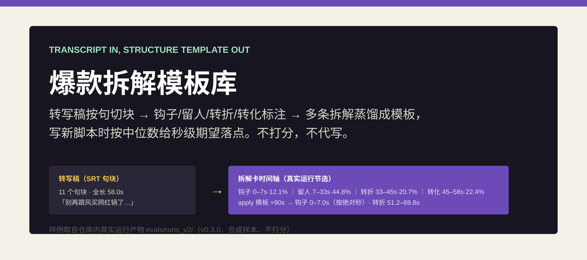
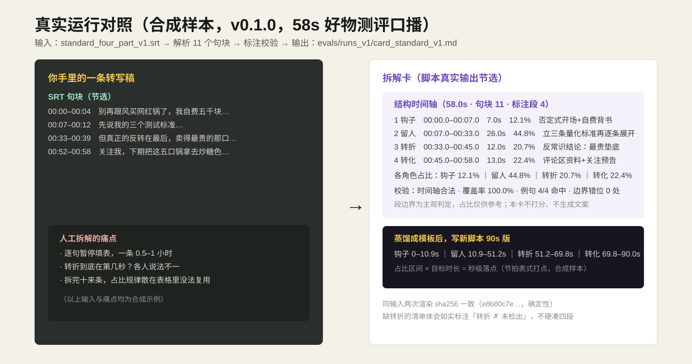
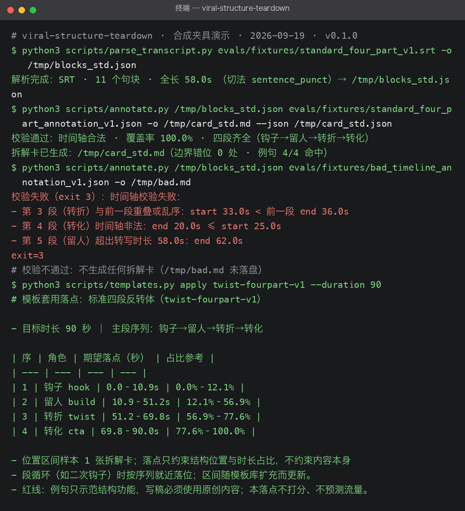
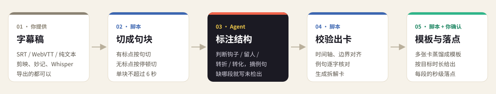

# 爆款拆解模板库

**把对标爆款的字幕稿拆成「钩子 → 留人 → 转折 → 转化」时间轴，攒成模板，写新脚本时直接知道每段该落在第几秒。**

---

## 效果展示

给它一条 58 秒好物测评口播的字幕稿，它会交回一张**拆解卡**：四段各在第几秒、占多少比例、哪句话撑起这一段，并逐项校验。拆解卡攒成模板后，换成 90 秒的新脚本，也能直接给出每段的落点。

  

图中数字全部摘自仓库里的真实运行产物：[完整拆解卡](evals/runs_v2/card_standard.md) · [90 秒落点](evals/runs_v2/apply_twist_fourpart_90s.md)。示例稿是合成样本。

<b>再看一段真实终端输出</b>（Whisper 转写的字幕解析、标注校验、模板落点、两人标注一致性）

 

  

每个字符都来自终端输出，原始记录见 [transcript](docs/assets/live-teardown-terminal.transcript.txt)。第一条输入是一段 CC BY-SA 授权的普通话音频经 Whisper 转写的字幕，其余是仓库自带的样本。

## 它能做什么

- **读懂常见字幕**：剪映、飞书妙记、Whisper 导出的 SRT / WebVTT 都能直接用；没标点的稿子也会按停顿切成一般不超过 6 秒的短句块。
- **拆出四段结构**：Agent 判断钩子、留人、转折、转化各在哪，给出时长、占比、语速和代表例句；缺哪段就写“未检出”，不硬凑。
- **脚本把关，结果可复查**：时间轴是否合法、段边界是否对齐、例句是否真在那一段里，全部由本地脚本逐项核对。
- **沉淀成模板**：同类爆款拆够几条，就蒸馏成模板，记下每段起止的中位数和观测范围。
- **给新脚本定骨架**：按目标时长算出每段的秒级落点；钩子按样本的绝对秒数封顶，不会被长视频拉长；样本不够或时长差太多时会直接提醒。
- **对齐两个人的拆法**：两人各拆一遍同一条视频，报告会指出分歧在哪几个句块、差几秒。

## 适合谁

| 你是谁 | 手里有什么 | 能拿到什么 |
| --- | --- | --- |
| 短视频编导、口播博主 | 对标爆款的字幕稿 | 一张拆解卡：四段时间轴、占比、例句和结构总评 |
| 拆解爱好者、培训讲师 | 十几条同类爆款的拆解 | 可复用的结构模板库 |
| 代运营、接新选题的博主 | 一个选题和目标时长 | 新脚本每段该落在第几秒 |
| 团队编导、训练营助教 | 两个人对同一条视频的拆法 | 一份分歧报告，交给人拍板 |

## 如何安装

把这个仓库的 GitHub 地址发给你正在用的 Claude Code、Codex 或其他支持 Skills 的 Agent，对它说：

> 请把这个仓库安装成 Skill，装好后确认它出现在可用 Skills 里。

也可以下载压缩包，把解压后的**完整文件夹**放进 Agent 的 Skills 目录。不要只拿走 SKILL.md，脚本和参考资料要一起装。只需要 Python 3，不需要任何密钥或平台账号。手动安装和参数说明见 [docs/usage.md](docs/usage.md)。

## 如何使用

装好后直接用自然语言说：

> 这是我的对标爆款字幕（SRT），帮我按钩子、留人、转折、转化拆一下结构。

> 这三条拆解都是同一类知识口播，帮我沉淀成模板。

> 用刚才的模板，给我一条 75 秒新脚本的分段落点。

> 我和同事各拆了一遍这条视频，看看我们俩在哪几段分歧最大。

蒸馏模板前，Agent 会先请你确认。落点里的“外推”“冷启动”等提示会原样转告你。例句只用来说明这一段起什么作用，写稿时请换成自己的内容。

## 对标与参考

| 参考对象 | 它们怎么做 | 本项目的做法 |
| --- | --- | --- |
| 蝉妈妈「AI拆视频」 | 粘贴链接，多维度拆文案、分镜、画面 | 只看字幕稿，专注结构和节奏 |
| YouTube 留存关键时刻 | 用真实留存曲线度量前 30 秒 | 同样按绝对秒数看开头 |
| TikTok 官方创意建议 | 3 秒亮主张，6 秒内完成钩子 | 拆解卡里给出钩子止于第几秒，仅作对照 |
| 开源同类 Skill（如 WOW 爆款拆解机） | 交给大模型口述，部分给 0–100 分 | 不打分，时间轴和例句交给脚本校验 |

完整对比和每条阈值的出处见 [references/benchmarks.md](references/benchmarks.md)。

## 效果怎么验证

每个能力都有对应的评测用例，产物都提交在仓库里，可以一键复现，同一输入重复运行的结果完全一致。题集、评分标准和逐题判断见 [evals/README.md](evals/README.md)。

## 边界与注意事项

- **段边界是主观判断**：同一条稿子不同人拆，转折点可能不同。脚本只保证结果合法、一致，不保证“判对了”。
- **只看字幕，不看画面和数据**：不分析分镜，不读留存或流量数据，也说不出某个结构“为什么留得住人”。
- **不打分、不代写**：不评价内容好坏，不预测流量，不生成或改写文案。
- **模板库还在冷启动**：自带的 5 个模板由合成样本蒸馏而来，每个只有 1–2 条样本。用自己的真实拆解去扩充，模板才有参考价值。
- **隐私**：全部在本地运行，不抓取任何平台的视频；纯文本稿没有时间码，只能切块，做不了时间轴。

## 社区与许可

- 社区讨论：[LINUX DO](https://linux.do/)
- 许可证：[Apache License 2.0](LICENSE)。样本来源和引用说明见 [NOTICE](NOTICE)。
