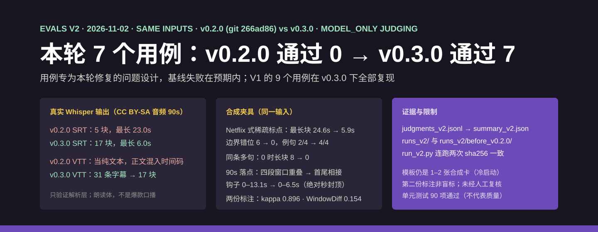

# 爆款拆解模板库 viral-structure-teardown

  

爆款拆解模板库：把爆款视频转写稿按钩子、留人、转折、转化标注结构，沉淀成写新脚本能套用的模板。
拆一条爆款不用再逐句暂停填表——转写稿进来，脚本按句切块、校验时间轴与例句，Agent 判定每段角色
并解释这条爆款的套路；拆得多了，多条拆解自动蒸馏成带占比区间的结构模板，写新脚本时直接给出
秒级期望落点。全程本地运行，不打分、不代写、不抄任何人的文案。

## 首屏实测

一条 58 秒合成测评口播的真实运行：解析 → 标注校验 → 非法标注被拦截 → 模板落点换算，全程逐字来自实际执行（命令上下文见终端首行，记录存于 [docs/assets/live-teardown-terminal.transcript.txt](docs/assets/live-teardown-terminal.transcript.txt)）：

  

## 使用场景

| 场景 | 你是谁 | 什么时候用 | 它帮你干什么 |
| --- | --- | --- | --- |
| 拆对标爆款的结构 | 短视频编导 / 口播博主 | 找到一条对标爆款，手里有它的转写稿（SRT） | 产出一张拆解卡：钩子/留人/转折/转化的时间轴、占比、例句和结构总评，缺转折就如实标缺 |
| 沉淀自己的结构库 | 拆解爱好者 / 培训讲师 | 拆了十几条同类爆款，想让规律可复用 | 多条拆解一键蒸馏成模板：段序列模式 + 每段占比区间 + 句式模式，可长期维护在本机 |
| 写新脚本前定骨架 | 口播博主 / 代运营 | 接了新选题，知道内容但不知道节奏怎么排 | 按模板把占比区间换算成目标时长的秒级落点，逐段出提纲，例句只示范功能、内容自己写 |
| 批量核对学员作业 | 拆解训练营助教 | 学员交来的拆解表边界随手画 | 脚本统一校验时间轴合法性与覆盖率，切开的句块、漏标的区间逐条列出 |

不适合的场景：视频画面/分镜分析、流量数据预测、内容质量打分、代写或改写文案——它只做转写稿的
结构层标注与模板沉淀。

## 它解决什么问题

「拆爆款」早被市场验证过付费意愿：蝉妈妈把「AI拆视频」做成年费 ¥1,398 档的会员卖点，
飞瓜数据年费 ¥3,998 档覆盖素材监测，拆解训练营人均 ¥5,000 教人工拉片；GitHub 上相关开源
项目全部不足 50 star 且几乎全是生成器/爬虫，「转写稿 → 结构标注 → 模板库沉淀」这一格是真空
（调研见[对标文档](references/benchmarks.md)）。本仓库只做这一格：结构标注、模板沉淀、
落点换算三步全部确定性脚本化，人工只判断段落角色——不碰画面与数据层，也正因不打分，
不与数据平台正面竞争。

  

上图取自仓库内真实运行产物（[输入夹具](evals/fixtures/standard_four_part_v1.srt) →
[拆解卡](evals/runs_v1/card_standard_v1.md)，人工编写的合成样本）：四段各落在设计位置、
占比与例句逐条可核，边界主观与不打分声明印在每张卡上。

## 能力与边界

| 能力 | 边界 |
| --- | --- |
| SRT/纯文本解析：按句切块、无标点按 >0.8s 停顿或定长切、时间戳对齐 | 无时间码的纯文本无法做时间轴标注，会明确拒绝而不是虚构时间戳 |
| 四段式标注校验：时间轴合法性、覆盖率、边界对齐、例句命中，全部确定性可复现 | 段边界是主观判定：同一稿子两次标注的转折点可能不同，占比只存区间 |
| 四段不齐如实标注：清单体没有转折就写「转折 ✗ 未检出」，绝不硬凑 | 段角色判定（哪句算钩子）由 Agent 完成，依据是手法口径与例句，需人工复核 |
| 模板蒸馏与落点：段序列模式 + 占比区间 → 秒级打点（节拍表式） | 模板库冷启动样本少，落点区间偏宽且样本量随产物披露，随拆解扩充收窄 |
| 红线：不打分、不预测流量、不代写；例句仅佐证结构功能 | 它不告诉你「这条好不好」，只告诉你「结构长什么样」 |

## 如何安装与使用

把本仓库放入你的 Agent 技能目录，然后直接对 Agent 说：

> "这是我的对标爆款转写稿（SRT），帮我按钩子、留人、转折、转化拆一下结构，然后把这几次拆解沉淀成模板，再给我一条 90 秒新脚本的期望落点。"

Agent 会先用解析脚本把转写稿切成带时间戳的句块，再归类每段角色并摘例句，校验通过后生成
拆解卡并向你解释这条爆款的套路；多条拆解后蒸馏成模板入库，写新稿时按目标时长换算出各段的
秒级落点。段边界仅供人工复核，例句必须替换成你自己的原创内容。命令行参数与退出码见
[维护文档](docs/usage.md)。

输入材料：一条转写稿（SRT 优先，纯文本需带标点或接受按长度切块）；模板库是本机
templates 目录下的一组 JSON，可自行增改。

## 评测结果

V1 评测（2026-09-19，v0.1.0，全部使用合成夹具）：**9/9 用例通过，0 硬失败**，单元测试
44/44。覆盖标准四段落位、缺转折如实标注、双钩子循环、坏时间轴拦截、无标点切块、确定性
（同一标注两次渲染 sha256 一致）、模板蒸馏与落点、红线检查、例句错位回归九类行为。

  

- 逐题判断：[judgments_v1.jsonl](evals/judgments_v1.jsonl)；汇总：[summary_v1.json](evals/summary_v1.json)
- 真实产物与哈希：[evals/runs_v1/](evals/runs_v1/)；夹具设计段位公开在[夹具说明](evals/fixtures/README.md)，标注是否落在设计位置可逐段机械核对
- **诚实披露**：判定为开发 Agent 自评（model_only），尚未独立人工复核；模板位置区间目前
  仅 1 张卡支撑（冷启动期，样本量已随产物注明）。开发中真实发现并修复了三个缺陷
  （CLI 参数位置、非法段夹中间时的重叠漏检、无时间码输入不设防），过程见
  [迭代记录](evals/iteration_notes.md)。

## 对标与定位

与蝉妈妈 AI拆视频（¥1,398/年）、飞瓜数据（¥3,998/年）、拆解训练营（¥5,000/人）及
GitHub 开源生成器的逐项对比，以及「只做文案结构子集、模板归用户、不打分」的立场，
见[对标文档](references/benchmarks.md)。

需求来源：自媒体需求雷达对公开信号的研究（problem_key `viral-structure-teardown`：
工具位真空 + 付费锚点 + 人工拆解 0.5–1 小时/条的效率缺口）。

## 社区与许可

- 社区讨论：[LINUX DO](https://linux.do)
- 许可证：Apache License 2.0（见 [LICENSE](LICENSE)，夹具合成与方法论来源说明见 [NOTICE](NOTICE)）
